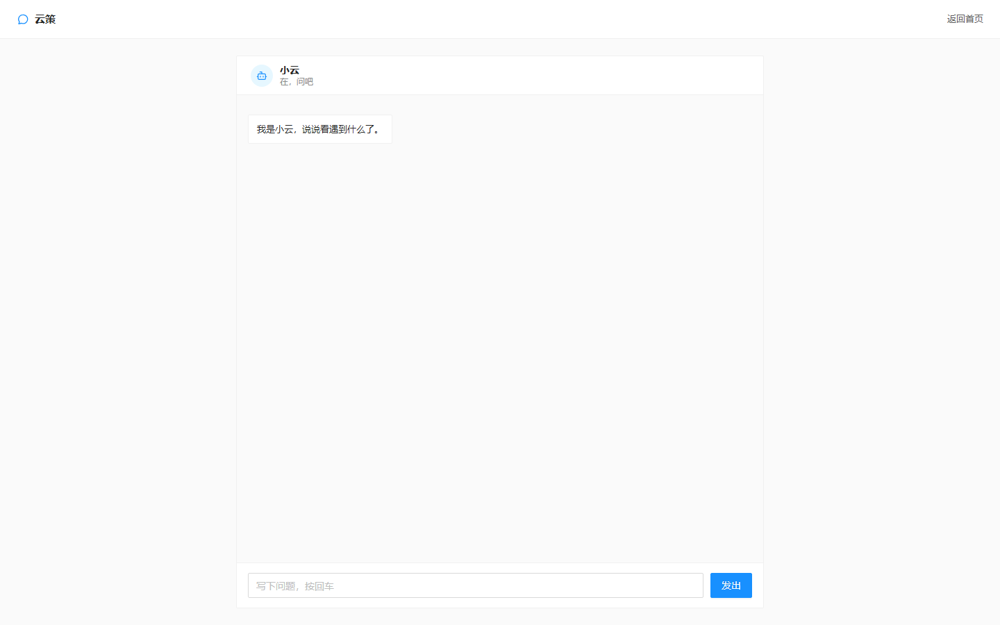

# 云策 · RAG 问答演示

一套知识问答演示，分为四个页面：产品介绍、用户问答、坐席工作台、资料维护。支持口语提问与多轮追问，答案从 8 份业务文档中检索后由模型组织成整条回复。

[产品介绍](客户页.html) · [用户问答](用户端.html) · [坐席工作台](坐席页.html) · [资料维护](运维页.html) · [评测报告](docs/评测报告.md) · [服务端验收](docs/服务端验收.md) · [知识库样例](知识库样例/01-产品功能说明.md) · [服务端](rag_server.py)





## 快速开始

双击 `start-server.bat`，浏览器打开 `http://127.0.0.1:8900/`。

首次运行会生成 `config.json`。模型 Key 可填在文件中，也可通过环境变量 `SHANGTANG_API_KEY` 与 `SILICONFLOW_API_KEY` 读取；两处均为空时仍可问答，回复由服务端从资料中摘录。密钥不下发到浏览器。

| 项目 | 要求 |
| --- | --- |
| 浏览器 | Chrome |
| 服务端 | Python 3，检索与取文只用标准库 |
| 换 MySQL 时 | 另装 `pymysql` |
| 评测脚本 | Node 18+ |

## 四个页面

- **产品介绍**：说明用途、能力与接入方式。首屏按钮进入用户问答页，页面内不放置对话窗。
- **用户问答**：单栏对话，居中 760 宽。提问写入数据库，回答附带命中段落。
- **坐席工作台**：左会话、中对话、右访客信息。会话与消息由数据库读写，接入、收发、结束均更新库中状态。
- **资料维护**：左资料、中正文、右调试。支持上传文档、查看命中段落与提示词、查看最近问答记录。

## 技术栈

- 服务端：Python 标准库 `http.server`，负责知识库读取、切块、索引、检索、提示词拼装与模型调用。
- 数据层：`db.py`，默认 SQLite，可切 MySQL。四张表 documents、sessions、messages、qa_logs，均建索引。会话与消息从库读写，每次提问写入一条问答记录。
- 取文：`docparse.py`，支持 Word、Excel、PDF、纯文本，不依赖第三方库。Word 与 Excel 解压读内部 XML，PDF 解压内容流后按文件自带的 ToUnicode 表还原文字。
- 前端：四个独立页面，共用 `assets/app.js` 调接口与渲染消息，浏览器内不保存数据副本。
- 样式：Ant Design 4 样式表（`assets/vendor/antd.min.css`）与一套色板，除主色外不引入其他颜色。
- 模型：对话用商汤 `sensenova-6.8-flash-lite`，向量用 `BAAI/bge-m3`（1024 维）。向量未启用时使用关键词检索。
- 接口：`/api/health`、`/api/config`、`/api/docs`、`/api/doc`、`/api/search`、`/api/vectors/build`、`/api/chat`、`/api/upload`、`/api/sessions`、`/api/session`、`/api/session/take`、`/api/session/end`、`/api/session/message`、`/api/qa`、`/api/stats`、`/api/db`。

## 切换数据库

默认 SQLite，数据在 `data.db`，不纳入版本库。首次启动自动建表并写入五条演示会话，之后不再覆盖。

切换 MySQL 分四步：一、以管理员身份执行 `net start MySQL80`；二、建库 `CREATE DATABASE yunce DEFAULT CHARSET utf8mb4;`；三、将 `config.json` 中 `db.type` 改为 `mysql`，填写账号、密码与库名；四、重启服务。

建表、写入种子数据与资料入库均自动完成，业务代码无需改动。数据库连接失败时服务仍可启动，资料维护页顶栏标注「数据：MySQL（未连上）」并给出原因。

## 问答链路

意图路由（寒暄、身份、转人工由规则处理）→ 查询改写 → 检索 → 证据判定 → 资料不足时补关键词重查再判定 → 拼装提示词 → 模型生成 → 整条送达。

知识库按「一、二、三」中文序号分节，节内按句累加到 220 字一块、重叠 40 字。检索采用 TF-IDF 与向量双路，向量未启用时使用单路；改写句与原句各查一次，改写句 Top1 高出 3 个百分点才采用。证据判定由模型给出可用块编号，判定资料不足时补关键词重查一次。

## 评测

`eval/评测集.jsonl` 共 23 条标注题，覆盖条款问答、多轮追问、无答案与越权场景，20 条有标注答案，3 条为无答案或越权题。

**以下结果生成于文档重排之前**，当时切块为 78 块、按 Markdown 标题分节。文档改为按中文序号分节后切块变为 61 块，未复跑；评测脚本原调用的页面侧入口 `rank(q)` 已随页面改版移除，脚本需重新接入后方可复跑。以下结果仅对当时版本有效，引用时需注明版本与日期。

| 指标 | 结果 | 样本 | 测量方式 |
| --- | --- | --- | --- |
| Hit@1 | 16 / 20 = 80.0% | 20 条 | Top1 命中标注文档与小节 |
| Hit@3 / Hit@5 | 18 / 20 = 90.0% | 20 条 | 前 3 / 5 块中至少一块命中 |
| 文档命中@1 | 18 / 20 = 90.0% | 20 条 | Top1 只比对文档标题 |
| MRR | 0.842 | 20 条 | 首个正确结果排名的倒数平均 |
| 平均要点覆盖率 | 81.8%，全覆盖 8 / 11 | 11 条 | 标注关键词出现在回复中 |
| 拒答 / 不编造 | 2 / 3 | 3 条 | 规则判定 |
| 端到端延迟 | 平均 21.8 秒，P50 20.2 秒，P95 34.3 秒 | 14 题 | 12.7 至 40.7 秒 |
| 调用失败 | 0 / 14 | 14 题 | 请求报错或界面未完成回复 |

## 已知限制

- 多轮省略追问存在误命中：连续提问时，追问句可能命中其他主题的小节。
- 业务问题端到端延迟 12.7 至 40.7 秒，链路各步骤串行执行。
- 上传只取文字层，扫描件和加密文档取不出内容，会提示换文件。
- 服务端运行在本机 127.0.0.1，无公网地址，无登录鉴权。
- 当前范围是条款问答演示，工单流转、权限体系、业务系统对接在范围之外。

## 目录结构

```
RAG客服演示-作品集/
├── README.md              项目说明
├── 客户页.html             产品介绍页
├── 用户端.html             用户问答页
├── 坐席页.html             坐席工作台页
├── 运维页.html             资料维护页
├── assets/
│   ├── app.js             四页共用：调接口 + 渲染消息
│   ├── theme.css          色板与消息气泡样式
│   └── vendor/antd.min.css  Ant Design 4 样式表
├── rag_server.py          服务端：检索、判定、生成、接口
├── db.py                  数据层：SQLite 与 MySQL 双引擎
├── docparse.py            取文：Word、Excel、PDF、纯文本
├── data.db                SQLite 数据文件，不纳入版本库
├── config.example.json    配置样板
├── start-server.bat       启动脚本
├── 知识库样例/            8 份业务文档
├── docs/
│   ├── 评测报告.md
│   ├── 服务端验收.md
│   └── images/            四张界面图
├── eval/
│   ├── 评测集.jsonl
│   ├── 评测结果.json
│   ├── 评测脚本.js
│   └── 生成报告.py
└── scripts/
    └── 截图.js
```
