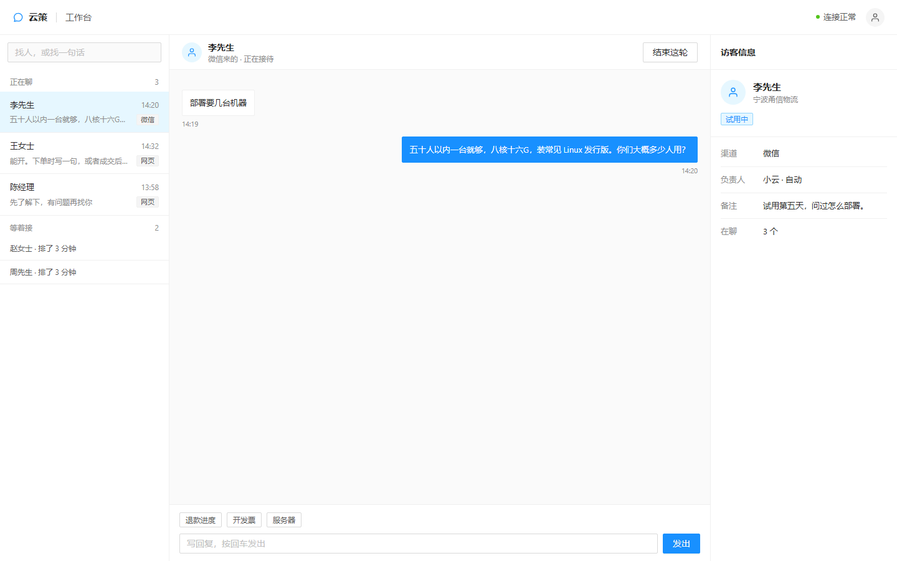
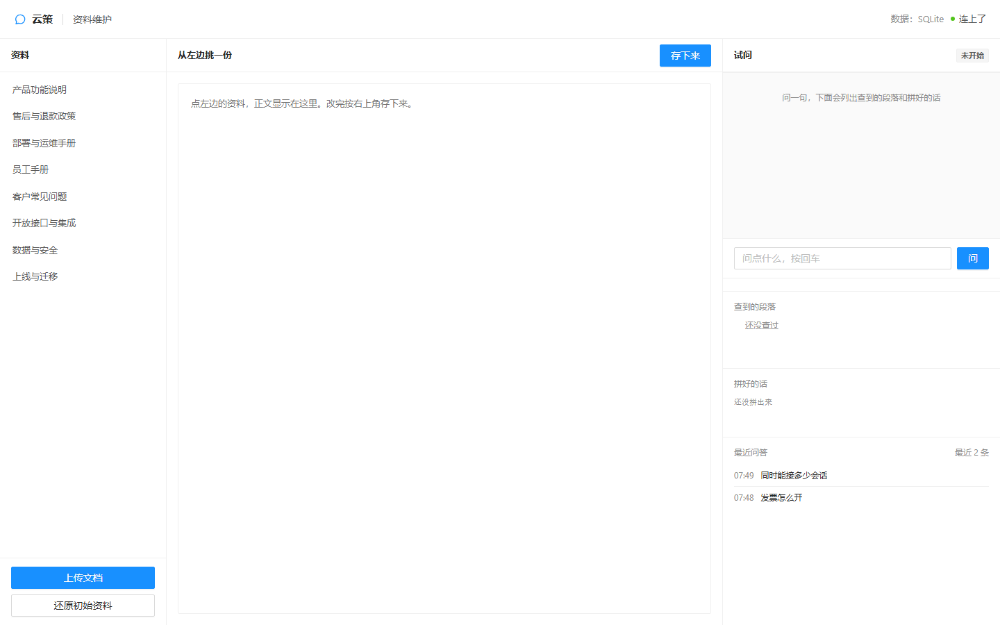

# 云策 · RAG 问答演示

售前售后条款分散在 8 份业务文档中，提问时检索相关段落、判定是否够用，再由模型组织成整条回复。

## 快速开始

双击 `start-server.bat`，浏览器打开 `http://127.0.0.1:8900/`。首页是产品介绍，按钮进用户问答，另有坐席工作台与资料维护两页；`知识库样例/` 提供 8 份可直接使用的文档。首次运行生成 `config.json`，模型 Key 填在文件里或走环境变量。检索与生成在服务端完成，直接打开 HTML 只能看排版。

## 功能特性

- **分节切块**：按「一、二、三」中文序号把文档分节，节内按句累加到 220 字一块、重叠 40 字，避免一句话被截断。
- **双路检索**：关键词与向量各查一次，改写句与原句同时检索，改写句 Top1 高出 3 个百分点才采用。
- **意图路由**：寒暄与转人工走规则，业务问题再进改写、检索与证据判定，不做无依据回答。
- **不足重查**：判定资料不足时补关键词重查一次，仍不足则按未答处理。
- **记录入库**：会话与问答记录写进数据库，SQLite 与 MySQL 共用同一套表与索引，改配置即换库。
- **文档入库**：支持 Word、Excel、PDF，用标准库解压与 ToUnicode 映射取文，不依赖第三方库。

## 技术实现

服务端是 Python 标准库 `http.server`，页面只负责交互与展示，检索、判定、生成全在服务端完成。

章节由行首的中文序号识别，节内按句切分后累加到 220 字，相邻块保留 40 字重叠。检索打分合并两路：关键词按词频与逆文档频率计分，向量按余弦相似度计分，两路归一后相加排序。证据判定由模型输出可用块编号，编号为空则判定资料不足，补一轮关键词重查再判定。

取文不引第三方库：Word 与 Excel 本身是 zip 包，解压后读 `word/document.xml` 与 `xl/sharedStrings.xml`；PDF 用 zlib 解压内容流，再按文件自带的 ToUnicode 映射表逐字还原。

数据层 `db.py` 分开写两套语句，SQLite 用 `INSERT OR REPLACE`，MySQL 用 `REPLACE INTO`，表结构与索引一致。库连不上时服务照常启动，顶栏标注未连上。

## 验收结果

本机无头浏览器逐项验收，四个页面均无 JS 报错，逐项数据见下表，脚本与结果在 `eval/`。

| 项目 | 实测 |
| --- | --- |
| 知识库 | 8 份文档，61 块 |
| 页面 | 4 个，JS 报错 0 条 |
| 切块 | 220 字一块，重叠 40 字 |
| 文档取文 | PDF 中文 43 字完整还原 |
| 会话 | 5 条入库，收发与状态变更落库 |
| 问答 | 发票、会话上限、退款到账三类问题均答对 |

## 已知限制

- 服务端跑在本机 127.0.0.1，无公网地址；无登录鉴权。
- 向量未启用时退回关键词单路，同义改写的问题命中率下降。
- 扫描件与加密文档取不出文字，会提示换文件。
- 评测集 23 题，数据生成于文档重排之前，重排后未复跑。
- 当前范围是条款问答演示；工单流转、权限体系、业务系统对接在范围之外。
