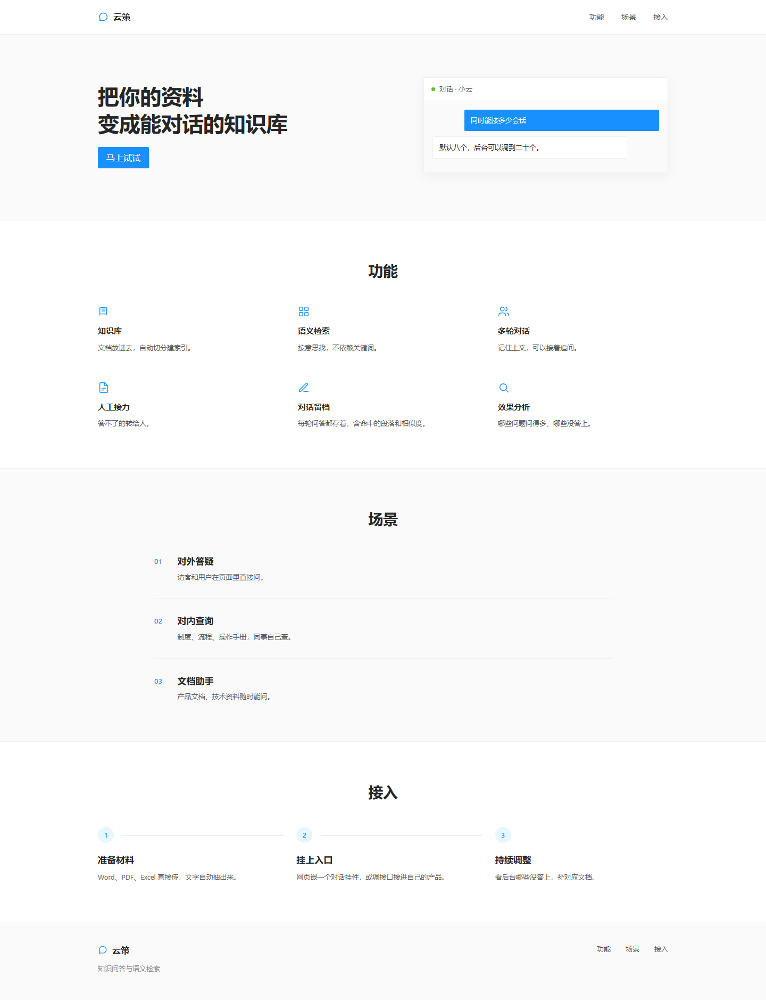

# 云策 · RAG 问答演示

售前售后条款散在 8 份业务文档里，应答要来回翻手册。这套工具把文档切块建索引，提问时检索、判定、生成，整条回复返回。

## 快速开始

双击 `start-server.bat`，浏览器打开 `http://127.0.0.1:8900/`。首页是产品介绍，右上角按钮进用户问答，另有坐席工作台与资料维护两页。

首次运行生成 `config.json`，模型 Key 可填在文件里，也可走环境变量 `SHANGTANG_API_KEY` 与 `SILICONFLOW_API_KEY`。页面是静态的，问答要走服务端，直接双击 HTML 只能看排版。

## 功能特性

- 产品介绍、用户问答、坐席工作台、资料维护四个页面，共用一套 Python 服务端，页面只管交互与展示。
- 知识库按「一、二、三」中文序号分节，节内按句累加到 220 字一块、重叠 40 字。
- 检索用 TF-IDF 与向量双路，改写句与原句各查一次，改写句 Top1 高出 3 个百分点才采用。
- 意图路由、查询改写、证据判定，判定资料不足时补关键词重查一次再判定。
- 会话与问答记录写进数据库，SQLite 与 MySQL 一套代码切换，改一行配置即可换库。
- 文档上传支持 Word、Excel、PDF，用标准库解压与 ToUnicode 映射取文，不依赖第三方库。

## 技术实现

服务端是 Python 标准库 `http.server`，检索、判定、生成全在服务端，浏览器里不放数据副本。

切块按章节走，不按固定字数硬切，避免一句话被拦腰截断。检索两路合并打分：关键词负责术语命中，向量负责同义改写。证据判定由模型给出可用块编号，判定不足时补一轮关键词重查。改写句与原句同时检索，改写句的 Top1 要高出 3 个百分点才采用，否则仍按原句结果走。

取文不引第三方库。Word 与 Excel 本身是 zip 包，解压后读内部 XML；PDF 解压内容流，再按文件自带的 ToUnicode 映射表还原文字。

数据层 `db.py` 管两套语句，SQLite 与 MySQL 的表结构、字段、索引一致，换库只改连接方式。库连不上时服务照常启动，顶栏标注未连上。

## 验收结果

本机无头浏览器逐项验收，四个页面均无 JS 报错。

| 项目 | 实测 |
| --- | --- |
| 知识库 | 8 份文档，61 块 |
| 页面 | 4 个，JS 报错 0 条 |
| 切块 | 220 字一块，重叠 40 字 |
| 文档取文 | PDF 中文 43 字完整还原 |
| 会话 | 5 条入库，收发与状态变更落库 |
| 问答 | 发票、会话上限、退款到账三类问题均答对 |

## 已知限制

- 服务端跑在本机 127.0.0.1，没有公网地址，也没有登录鉴权。
- 向量未启用时退回关键词单路，同义改写的问题命中率会下降。
- 扫描件与加密文档取不出文字，会提示换文件。
- 评测集 23 题，数据生成于文档重排之前，重排后未复跑。
- 当前范围是条款问答演示，工单流转、权限体系、业务系统对接在范围之外。
